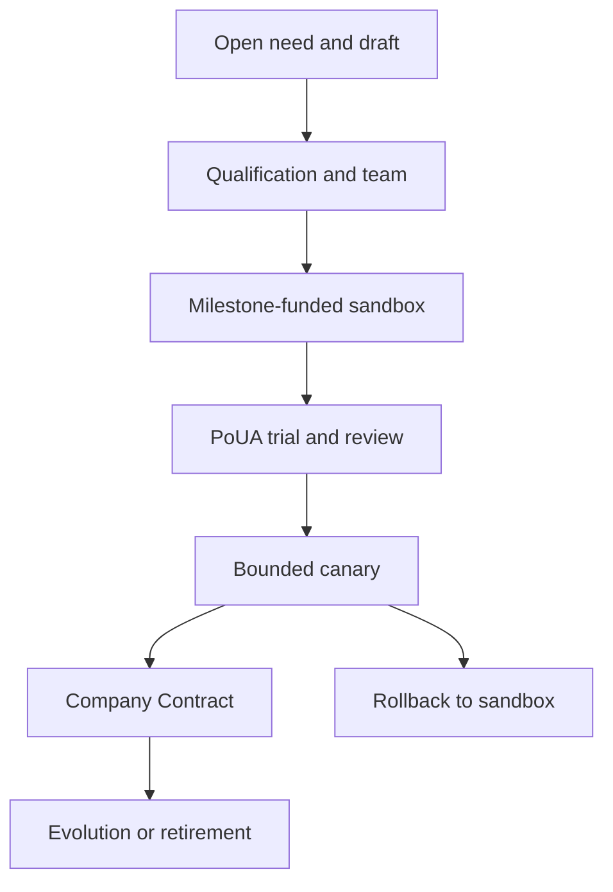

# Subway Runner PoC v0.3.2

This package is the executable vertical slice for the **Subway Runner Society Engine Protocol v1.0 (SEP)**. It is not a generic “game plus token” demo.

The Subway Runner is Product 001: a real playable core loop that starts as an open player need, stays isolated in the Innovation District, proves voluntary useful adoption, enters a bounded canonical canary, and may graduate into a recoverable Company Contract.

> Protocol thesis: growth is earned through useful player adoption - not mining, raw votes, wallet count, transactions, asset count or speculative capital.

## What is included

- Playable Three.js/Vite three-lane Subway Runner with keyboard, touch and guest play
- EVM wallet identity using injected wallets or WalletConnect
- Server-attested, one-time run receipts paid from a pre-funded season budget
- The complete 12-state SEP proposal-to-product lifecycle
- Refundable qualification bond with a narrow spam-forfeiture path
- Milestone-only prototype funding with independent release review and refunds
- Proof of Useful Adoption (PoUA) with precommitted metrics, seven evidence categories and reviewer diversity
- Isolated Innovation District status and bounded canonical canary limits
- Bounded Company Contract capabilities, revenue route, maintenance reserve, timelocked evolution and scoped isolation
- Versioned Game Asset Manifests with rights, fallback rendering, validation, regional compatibility and quarantine
- Closed RUSH settlement credit with no token-weighted governance and no unrestricted peer-to-peer transfer rail
- Contract tests for successful graduation and a deliberately exercised recovery path
- Protocol-aligned proposal, PoUA, company, asset and recovery metadata packages

### Playable frontend v0.3

The frontend is no longer only the uploaded base runner wrapped in a protocol dashboard. This release rebuilds the play layer with:

- spring-damped three-lane movement, buffered jumps, fast-fall slides and responsive camera follow
- swept collision checks that prevent high-speed tunnelling through obstacles or credits
- accessible route alerts for jump, slide and lane-switch threats
- live Runner Flow, streak scoring, speed, distance, energy and route-sector telemetry
- four visually differentiated route sectors: Harbour Exchange, Civic Transfer, Innovation District and Canary Junction
- evidence-grade run summaries with duration, maximum speed, best streak, action mix and a local receipt ID
- device-local top-run history with no fabricated global competitors or prize pool
- a functional off-chain cosmetic exchange using earned test credits, with mechanical parity between every outfit
- responsive keyboard, swipe, touch-button and optional mobile-haptic controls
- rewarded-run telemetry explicitly marked as test activity and excluded from PoUA adoption evidence

The previous generic four-state lifecycle and token-voting model were removed. A service-token factory is intentionally **not** activated: the protocol says service tokens are not open by default and belong after utility and economic review.

## Protocol-to-code mapping

| Protocol requirement | PoC implementation |
|---|---|
| Section 05 - Proposal-to-Product Lifecycle | `contracts/ProductLifecycleRegistry.sol` |
| Section 06 - Proof of Useful Adoption | `contracts/ProofOfUsefulAdoption.sol`, `metadata/poua-trial.json` |
| Section 07 - Company Contract and operating model | `contracts/CompanyContract.sol`, `contracts/MilestoneVault.sol` |
| Section 09 - one settlement asset and bounded rewards | `contracts/RushToken.sol`, `contracts/RunRewardVault.sol` |
| Section 12 - versioned 3D/content standard | `contracts/GameAssetRegistry.sol`, `metadata/game-asset-manifest.json` |
| Section 13 - capability limits and telemetry adapter | `CompanyContract.executeCapability`, signed reward receipts |
| Section 15 - maintenance and recovery | maintenance reserve, continuation/recovery hashes, isolation and rollback tests |
| Section 16 - Phase B vertical slice | one playable region, Innovation District, proposal registry, milestone vault, company and asset registry |
| Section 17 - decision gates | published PoUA targets and automated boundary tests |
| Appendix D - constitutional prohibitions | fixed supply, no vote-only admission, no self-review, no direct canonical deployment, no unrestricted calls |

## Architecture



The on-chain control plane stores identity, status, evidence hashes, financial boundaries, capabilities and recovery references. Rendering, physics, high-frequency gameplay and raw telemetry remain off-chain.

### Contract stack

| Contract | Responsibility | Important boundary |
|---|---|---|
| `RushToken` | single closed settlement credit | fixed supply; no mint; no voting; transfers must touch an approved rail |
| `RunRewardVault` | server-attested season rewards | pre-funded budgets, per-run cap, replay protection and EIP-712 signatures |
| `ProofOfUsefulAdoption` | admission evidence | rewarded use excluded; seven categories; minimum three reviewers |
| `ProductLifecycleRegistry` | exact SEP state machine | no automatic progression; separate roles; PoUA required before canary |
| `MilestoneVault` | prototype backing | payment only for independently verified work; pro-rata cancellation refunds |
| `CompanyContract` | bounded operating charter | allowlisted destination/selector plus rate, value and region ceilings |
| `GameAssetRegistry` | Game Asset Manifest history | material changes create new versions; canonical use is region-specific |

## Product lifecycle

`ProductLifecycleRegistry` implements the states specified in Section 05:

| # | State | Required output | PoC control |
|---:|---|---|---|
| 0 | Need signal | problem and affected cohort | no funds or tokens |
| 1 | Draft proposal | scope, users, dependencies, budget and success criteria | editable concept plus qualification bond |
| 2 | Qualification | completeness/originality record | not approval; bond becomes refundable |
| 3 | Team formation | roles, conflicts and delivery capacity | proposer assembles voluntary team |
| 4 | Prototype funding | capped vault and milestone tests | independent release review |
| 5 | Sandbox build | playable build, source, assets and tests | isolated Innovation District |
| 6 | Adoption trial | precommitted cohort, thresholds and exclusions | rewarded/team use excluded |
| 7 | Admission review | signed category findings | no self-review; no vote-only pass |
| 8 | Canary launch | user, region, call, value and dependency bounds | rollback reference is mandatory |
| 9 | Graduation | Company Contract and maintenance reserve | scoped, revocable operation |
| 10 | Evolution | versioned charter extension | renewed review and timelock |
| 11 | Recovery / retirement | continuity and final accounting evidence | product-only isolation; no asset seizure |

The UI’s **Society Engine** panel renders all states and reads the deployed product, canary and PoUA records when addresses are configured.

## Proof of Useful Adoption

PoUA is application-level admission, not chain consensus. The trial commits definitions before data collection and requires evidence for:

1. Need
2. Function
3. Adoption
4. Integrity
5. Safety
6. Economic compatibility
7. Maintainability

The sample thresholds in `metadata/poua-trial.json` include 50 independent users, at least 30% return use, 70% task completion, a majority of unrewarded usage and 98% reliability. They are design targets for a trial, **not a claim that live adoption already occurred**.

Season reward runs are labeled rewarded test activity. They may test settlement reliability, but they do not count as voluntary adoption evidence.

## Quick start

Requirements: Node.js 22.13 or newer and npm 10-11. The frontend build uses Vite 8.2.2.

```bash
npm install
npm run dev
```

Open `http://localhost:5173`. Guest play works without a wallet.

Controls:

| Action | Keyboard | Touch |
|---|---|---|
| Move | `A` / `D` or left / right arrow | swipe left / right or use lane buttons |
| Jump | `W`, space or up arrow | swipe up or use jump button |
| Slide / fast fall | `S`, `C`, shift or down arrow | swipe down or use slide button |
| Pause | `Esc` or `P` | pause button |

Useful checks:

```bash
npm run check:js
npm run frontend:test
npm run game:test
npm run contracts:test
npm run build
npm run check
npm run audit:prod
```

## End-to-end local Web3 demo

The deployment script creates the seven-contract SEP stack, publishes Product 001, qualifies it with a separate local signer, attaches a milestone vault, registers the versioned runner asset and stops at **Sandbox build**. It deliberately does not fake PoUA or automatically graduate the product.

Terminal 1:

```bash
npm run contracts:node
```

Terminal 2:

```bash
npm run contracts:deploy -- --network localhost
npm run contracts:season -- --network localhost
```

Copy the addresses and product ID from `deployments/localhost.json` into `.env`:

```dotenv
VITE_CHAIN_ID=31337
VITE_RUSH_TOKEN_ADDRESS=0x...
VITE_RUN_REWARD_VAULT_ADDRESS=0x...
VITE_SEP_PRODUCT_REGISTRY_ADDRESS=0x...
VITE_SEP_POUA_ADDRESS=0x...
VITE_SEP_MILESTONE_VAULT_ADDRESS=0x...
VITE_SEP_COMPANY_ADDRESS=0x...
VITE_SEP_ASSET_REGISTRY_ADDRESS=0x...
VITE_PRODUCT_ID=0x...
VITE_REWARD_API_URL=http://localhost:8787
```

Start the protected local attestor and the game:

```bash
npm run reward-api
npm run dev
```

Import a funded Hardhat account into a development wallet, switch to chain `31337`, play a run, and claim its signed reward.

### Advancing a product record

`npm run contracts:product -- --network localhost` executes one explicit transition using the `SEP_*` values in `.env`. Supported actions are:

```text
qualify, team, fund, sandbox, trial, admission, canary,
graduate, evolve, rollback, retire
```

Each action must be sent by an account holding that step’s role. PoUA trial commitment, metric attestation and category reviews are separate so a single lifecycle script cannot manufacture admission.

## Reward security model

The browser never mints RUSH or selects a reward amount.

1. A connected player requests a short-lived run session.
2. The local/service attestor validates score, distance, coins, momentum, duration, action plausibility, maximum speed and rate limits.
3. It signs an EIP-712 receipt bound to player, run ID, season, reward, deadline, chain and vault.
4. `RunRewardVault` verifies the signer, season window, per-run ceiling, remaining season budget and replay state.
5. The vault transfers from an already funded closed-credit balance.

Production must persist run sessions and replay state in a shared datastore, authenticate trusted game servers, add anti-cheat review and place the signing key behind managed key infrastructure. The included service is a local PoC attestor.

## Closed settlement credit

RUSH represents the one initial game settlement credit from Section 09:

- exactly 1,000,000,000 units are created once
- no public or administrator mint function exists
- RUSH does not provide governance votes
- peer-to-peer transfer is not enabled unless one side is an approved settlement rail
- reward, milestone and company contracts are explicitly allowlisted rails
- the demo does not configure a public secondary market or promise redemption, yield or appreciation

## Asset and content integrity

`metadata/game-asset-manifest.json` describes identity, content, runtime, performance, gameplay, rights, provenance, safety and lifecycle data for the runner. `GameAssetRegistry` stores content hashes and version history.

A material change creates a new version. It cannot overwrite a previously reviewed manifest. A guardian may quarantine only the affected version, and fallback rendering preserves inventory legibility.

The included model and texture provenance is documented in `public/models/model-manifest.json`. Review source licenses before commercial distribution.

## Recovery drill

`metadata/recovery-drill.json` and the tests exercise the protocol’s recovery sequence. A canary dependency failure isolates Product 001 and returns it to Sandbox Build while unrelated products and player assets remain untouched.

Guardian powers cannot mint supply, transfer user assets or permanently alter governance.

## Production readiness boundary

This package is a proof of concept, not an audited or legally cleared production protocol.

Before public deployment, complete at least:

- independent smart-contract audit, invariant/fuzz testing and deployment review
- a real multi-party guardian multisig and governance timelock
- external verifier recruitment, conflict checks, review payment policy and appeals
- privacy-reviewed telemetry collection, retention and deletion procedures
- economy simulation for sources, sinks, concentration, progression and canary exposure
- signed content pipeline, malware scanning and regional creative review
- monitored adapters, key rotation, incident runbooks and live recovery exercise
- legal review of settlement credits, product backing, consumer terms, privacy and geography
- reproducible builds, supported dependency versions and operations ownership

The PoC intentionally excludes cross-chain bridges, a public protocol token, company investment instruments, guaranteed returns, unrestricted Company DAOs and permissionless canonical deployment.

## Project map

```text
contracts/       SEP control plane, settlement and test target
docs/            requirement-to-code traceability for the source protocol
metadata/        proposal, PoUA, company, asset and recovery evidence packages
public/          brand mark, runner model and environment textures
scripts/         deployment, lifecycle, season and validation utilities
services/        local signed run-receipt attestor
src/game/        playable runner and interface
src/web3/        wallet, registry, PoUA and reward integration
test/contracts/  boundary, graduation, recovery and settlement tests
test/game/       deterministic Runner Flow and evidence telemetry tests
```
